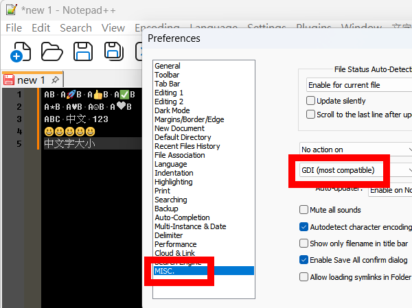

# GDI Emoji for Notepad++

GDI Emoji draws color emoji in UTF-8 documents in Notepad++'s GDI mode. The emoji drawing area targets the measured width of a CJK character in the default editor style, capped by the line height. Scintilla reserves a matching or slightly wider space and handles text layout, caret movement, and selection. Document bytes stay intact.

## Install and try it

Close Notepad++ x64, copy `NppGdiEmoji.dll` to `plugins\NppGdiEmoji\` under your Notepad++ folder, and restart Notepad++.

In **Settings → Preferences → MISC.**, select **GDI (most compatible)**. Open a UTF-8 document to see supported emoji automatically.



Paste these lines to check alignment, caret movement, and scrolling:

```text
A😀B A🚀B A👍B A✅B
A★B A♥B A☺B A❤️B
ABC 中文 123
```

The first line uses supported single-code-point emoji. The second line compares plain symbols with an emoji variation sequence. To compare text and emoji presentation directly, try `A✈B A✈️B A❤B A❤️B`.

## Preview limitations

- Supported text-default symbols such as ✈, ❤, and ✌ use the installed Segoe UI Symbol font and the editor style's foreground color. An emoji presentation sequence such as ✈️ uses Segoe UI Emoji.

- This build targets Windows 10/11 and Notepad++ x64 in GDI mode with UTF-8 documents. Color glyph coverage depends on Windows' Segoe UI Emoji font.
- The overlay supports standalone emoji with the `Emoji_Presentation` property and sends supported presentation variants, flags, skin-tone sequences, keycaps, and ZWJ sequences to the emoji font as complete sequences. Tag flags cover England, Scotland, and Wales. ZWJ sequences can contain up to eight elements. Sequence drawing targets a CJK character's width within the space Scintilla allocates. When the sequence crosses a visual line or the cell background is uneven, Scintilla paints the sequence.
- With a single caret, Left and Right arrow keys and plain clicks move the caret to supported sequence boundaries. Shift navigation and mouse selections also snap to sequence boundaries. Mouse selections are adjusted when the button is released.
- In GDI mode, U+FE0F reserves blank space as close to half a CJK character's width as the current font allows. This applies to every occurrence of the selector, including in sequences outside the overlay's coverage, and may affect wrapping.
- For documents up to 256 KiB, the overlay can compact 👩‍💻, 🏳️‍🌈, country flags, skin-tone sequences, tag flags, and keycaps with U+FE0F. Width changes apply only when the affected characters are used exclusively in sequences eligible for compaction and the font supports the required zero-width placeholder.
- The overlay scans up to the first 256 KiB of each visible document line.
- With word wrap enabled, the editor keeps its original glyphs and widths. The overlay can redraw an emoji in color when it fits on a single visual line. A sequence split across rows uses the editor's own rendering.

## Build

Add x64 MinGW-w64 (`g++.exe` and `windres.exe`) to `PATH`, then run the batch file from the project root. Packaging uses Windows' built-in PowerShell, `tar.exe`, and `certutil.exe`. The build has been checked with Strawberry Perl's toolchain.

```bat
.\build-x64.bat
```

Source files are in `src\`. The script creates `build\NppGdiEmoji.dll` and `release\NppGdiEmoji-<version>-x64.zip`, then prints the ZIP's SHA-256. Both output directories are ignored by Git. The DLL includes a Windows version resource.

## License

NppGdiEmoji is released under the **MIT License**. See [LICENSE](LICENSE).
